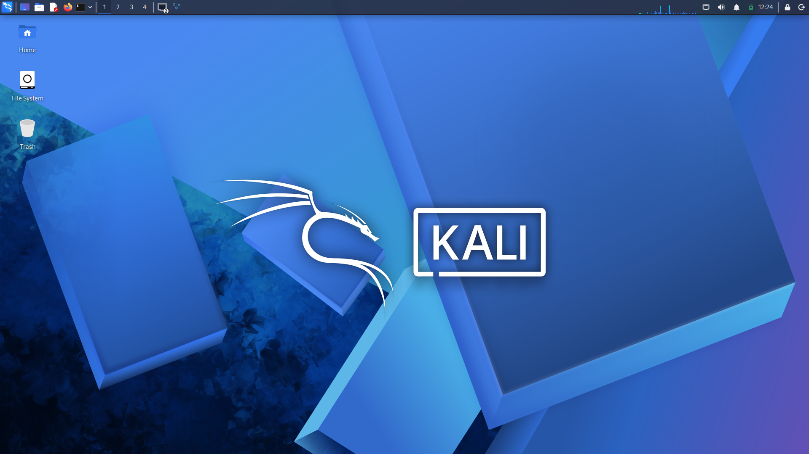
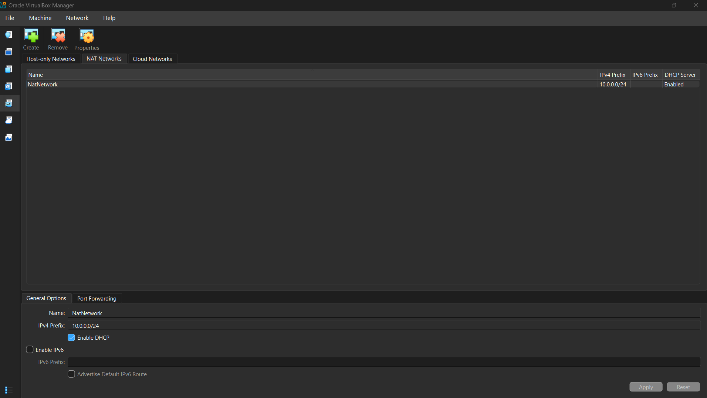
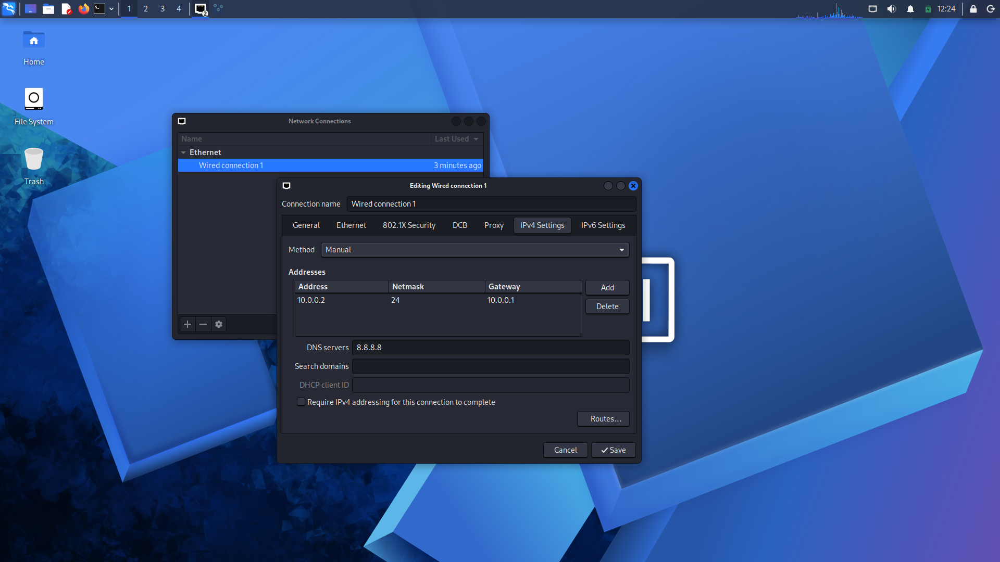

<div align="center">

# 🛡️ Cybersecurity Lab Setup

### VirtualBox • Kali Linux • Network Configuration

**Cybersecurity Int. B084D | Week 1 — Practical Module 1**

<p>
  
  
  
  
</p>

*A hands-on cybersecurity project focused on virtualization, network configuration, IP addressing, and connectivity testing.*

</div>

---

## 📌 Table of Contents

* [Project Overview](#-project-overview)
* [Objectives](#-objectives)
* [Lab Environment](#-lab-environment)
* [Network Architecture](#-network-architecture)
* [Network Configuration](#-network-configuration)
* [Implementation Steps](#-implementation-steps)
* [Verification and Testing](#-verification-and-testing)
* [Lab Screenshots](#-lab-screenshots)
* [Challenges and Troubleshooting](#-challenges-and-troubleshooting)
* [Key Learnings](#-key-learnings)
* [Tools and Technologies](#-tools-and-technologies)
* [Security and Ethical Use](#-security-and-ethical-use)
* [Project Information](#-project-information)

---

## 🎯 Project Overview

This project demonstrates the setup of a basic cybersecurity lab using **Oracle VirtualBox and Kali Linux** on a Windows 11 host machine.

A dedicated NAT Network named `NatNetwork` is configured to provide a virtual networking environment. Kali Linux is configured with a static IPv4 address, gateway, and DNS server.

The lab provides practical experience with virtualization, Linux networking, IP addressing, connectivity troubleshooting, and cybersecurity tools in a controlled environment.

## 🚀 Objectives

* Set up a virtualized cybersecurity lab.
* Install and configure Oracle VirtualBox and 7-Zip.
* Import and configure a Kali Linux virtual machine.
* Create a NAT Network with a custom IPv4 subnet.
* Configure static IP addressing, gateway, and DNS.
* Test gateway connectivity and internet access.
* Verify DNS resolution and network configuration.
* Configure virtual machine integration features.
* Create a virtual machine snapshot.
* Document the lab setup using screenshots.

## 💻 Lab Environment

### Host Machine

| Component        | Specification                   |
| ---------------- | ------------------------------- |
| Operating System | Windows 11 Home Single Language |
| Processor        | AMD Ryzen 7 7435HS              |
| Memory           | 24 GB RAM                       |
| Storage          | 512 GB                          |
| Architecture     | 64-bit                          |

### Virtualization Environment

| Component               | Configuration     |
| ----------------------- | ----------------- |
| Virtualization Platform | Oracle VirtualBox |
| Guest Operating System  | Kali Linux        |
| Network Mode            | NAT Network       |
| Network Name            | `NatNetwork`      |
| IPv4 Subnet             | `10.0.0.0/24`     |

## 🌐 Network Architecture

The lab uses a VirtualBox NAT Network to establish a virtual network for the Kali Linux environment.

```text
             HOST MACHINE
               Windows 11
                    |
             Oracle VirtualBox
                    |
          +----------------------+
          |      NatNetwork      |
          |    10.0.0.0/24       |
          +----------------------+
                    |
          +----------------------+
          |      Kali Linux      |
          |                      |
          | IP: 10.0.0.2/24      |
          | Gateway: 10.0.0.1    |
          | DNS: 8.8.8.8         |
          +----------------------+
                    |
             Network Testing
          Gateway / Internet / DNS
```

**Note:** The IP address, gateway, and DNS shown above are the configured values. Successful connectivity must be verified separately.

## ⚙️ Network Configuration

The following IPv4 settings were entered for the Kali Linux network connection.

| Parameter       | Value           |
| --------------- | --------------- |
| Connection Type | Wired Ethernet  |
| Network Name    | `NatNetwork`    |
| IPv4 Method     | Manual          |
| IP Address      | `10.0.0.2`      |
| Subnet Mask     | `255.255.255.0` |
| Default Gateway | `10.0.0.1`      |
| DNS Server      | `8.8.8.8`       |

### Understanding the Configuration

* **IP Address:** Identifies the Kali Linux interface within the configured subnet.
* **Subnet Mask:** Defines the network portion of the IPv4 address.
* **Default Gateway:** Provides a route for traffic destined outside the local subnet.
* **DNS Server:** Resolves domain names into IP addresses.
* **NAT Network:** Allows virtual machines on the configured network to communicate and access external networks through network address translation.

> **Important:** Verify that the configured IP address is available and that the gateway matches the actual VirtualBox NAT Network configuration.

## 🛠️ Implementation Steps

### Step 1: Install the Required Software

Install Oracle VirtualBox and 7-Zip on the Windows host machine.

### Step 2: Import Kali Linux

Import the Kali Linux virtual machine into VirtualBox and start it.

### Step 3: Create a NAT Network

Create a NAT Network named `NatNetwork` with the following IPv4 prefix:

```text
10.0.0.0/24
```

### Step 4: Configure the Virtual Machine Network

Open the Kali Linux virtual machine's network settings and select `NatNetwork` as the network attachment.

### Step 5: Configure the Kali Linux IP Address

Configure the network connection with these values:

* IP address: `10.0.0.2/24`
* Gateway: `10.0.0.1`
* DNS server: `8.8.8.8`

### Step 6: Verify Network Connectivity

Use Linux networking commands to inspect the interface, routing table, gateway connectivity, and internet access.

See the verification section below.

### Step 7: Configure Integration Features

Configure clipboard sharing, drag-and-drop, and a shared folder if required. Install and configure VirtualBox Guest Additions when necessary.

### Step 8: Create a Virtual Machine Snapshot

After verifying the network configuration and other required settings, create a snapshot of the working Kali Linux virtual machine.

A snapshot provides a restore point for recovering the virtual machine's previous state.

## 🧪 Verification and Testing

Run the following commands in the Kali Linux terminal.

### 1. Check the Network Interface

```bash
ip a
```

**Purpose:** Displays network interfaces and their assigned IP addresses.

### 2. Check the Routing Table

```bash
ip route
```

**Purpose:** Displays the routing table and default route.

### 3. Test Gateway Connectivity

```bash
ping -c 4 10.0.0.1
```

**Purpose:** Tests whether the configured gateway responds.

### 4. Test Internet Connectivity

```bash
ping -c 4 8.8.8.8
```

**Purpose:** Tests connectivity to a public IP address.

### 5. Test DNS Resolution

```bash
nslookup networkwalks.com
```

**Purpose:** Checks whether the DNS server can resolve the domain name.

### 6. Check Nmap Availability

```bash
nmap --version
```

**Purpose:** Displays the installed Nmap version, if available.

### Verification Checklist

| Test                          | Status                    |
| ----------------------------- | ------------------------- |
| Kali Linux boots successfully | Update after verification |
| Static IP configuration       | Configured; verify        |
| Gateway connectivity          | Pending verification      |
| Internet connectivity         | Pending verification      |
| DNS resolution                | Pending verification      |
| Nmap availability             | Pending verification      |
| Virtual machine snapshot      | Update after completion   |

**Testing note:** Update the checklist based on the actual command output. A failed ping alone does not always indicate a complete network failure because ICMP traffic may be filtered.

## 📸 Lab Screenshots

The following screenshots document the Kali Linux environment and network configuration.

### 1. Kali Linux Desktop

Displays the Kali Linux virtual machine running in the lab environment.



### 2. VirtualBox NAT Network Configuration

Shows the configured NAT Network used for the virtual lab environment.



### 3. Kali Linux Network Configuration

Shows the IPv4 settings entered for the Kali Linux network interface.



### 4. Network Connectivity Verification

After testing connectivity, add a screenshot showing the actual command output.

Suggested commands:

```bash
ping -c 4 10.0.0.1
ping -c 4 8.8.8.8
```

Save the screenshot as `4-network-connectivity.png`, upload it to the repository's root directory, and then add:


## 🔧 Challenges and Troubleshooting

### Static IP Configuration

A static IP address was configured through the Kali Linux network settings.

If connectivity fails, check the interface configuration, subnet, gateway, routing table, and possible IP address conflicts.

### NAT Network Connectivity

The guest network configuration must match the VirtualBox NAT Network settings.

If the connection does not work, verify the selected network adapter, gateway configuration, and network address assignment.

### DNS Resolution

If internet connectivity by IP address works but domain names do not resolve, inspect the DNS settings and test resolution with `nslookup`.

## 📚 Key Learnings

This practical exercise provides experience with:

* Virtual machine creation and management.
* VirtualBox NAT Network configuration.
* IPv4 addressing and subnet masks.
* Gateway and DNS configuration.
* Linux network diagnostic commands.
* Basic connectivity troubleshooting.
* Virtual machine snapshots and recovery.
* Technical documentation using GitHub.

## 🧰 Tools and Technologies

| Tool                       | Purpose                               |
| -------------------------- | ------------------------------------- |
| Oracle VirtualBox          | Virtualization                        |
| Kali Linux                 | Linux-based cybersecurity environment |
| 7-Zip                      | File extraction                       |
| Windows 11                 | Host operating system                 |
| GitHub                     | Project hosting and documentation     |
| Linux networking utilities | Network inspection and testing        |

## 🔐 Security and Ethical Use

This lab is intended for educational purposes and authorized cybersecurity practice.

Network scanning and security tools should only be used on systems and networks for which permission has been granted. Experiments should remain within the intended lab environment unless broader testing has been explicitly authorized.

## 👨‍💻 Project Information

| Field                  | Details                  |
| ---------------------- | ------------------------ |
| Project                | Cybersecurity Lab Setup  |
| Batch                  | Cybersecurity Int. B084D |
| Practical              | WK1-PM1                  |
| Platform               | Oracle VirtualBox        |
| Guest Operating System | Kali Linux               |
| Host Operating System  | Windows 11               |

---

<div align="center">

### Learn • Configure • Test • Document

**Cybersecurity Int. B084D**

*Hands-on learning through practical cybersecurity lab configuration.*

</div>
